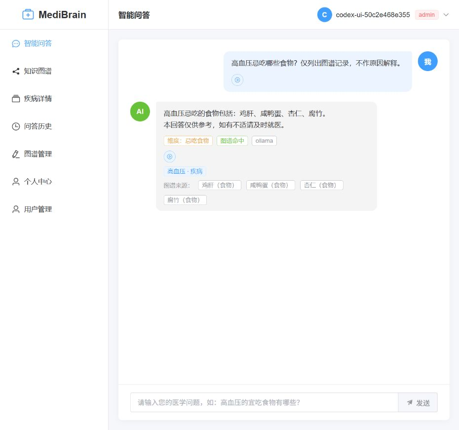
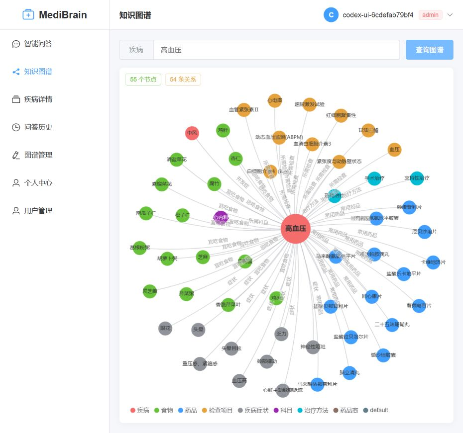

# MediBrain-Hospital 本轮完成记录

日期：2026-10-07。此前列出的剩余技术事项已处理，并发布到本机 `medibrain-prod` Kubernetes 集群。第一阶段记录见 [repairs-2026-10-07.md](repairs-2026-10-07.md)，其中“剩余事项”描述的是当时状态。

后续事实约束、语音缓存和性能 / 内容验收状态见 [2026-10-08 核对记录](acceptance-2026-10-08.md)。本文件后文为本轮初次完成时的历史状态；当前运行与最后发布状态以新记录为准。

## 当前使用方式

- 入口：http://localhost:8090 。前后端已运行，server 和 web 各 2 个就绪副本。
- 管理员：`medibrain-admin`。随机密码保存在 `apps/server/.env` 的 `ADMIN_BOOTSTRAP_PASSWORD`，没有写入本记录或终端输出。
- 普通用户可自行注册；管理员在“用户管理”页面为可信维护人员授予 `doctor` / `admin`，或启停普通账号。角色与状态变化即时作用于既有 token。
- 密钥轮换后原有登录需要重新登录。现有业务用户、密码和历史记录保留，另新增了上述管理员。
- 应用模型采用本机 Ollama `qwen2.5:7b`，向量模型采用本机 `bge-m3`；无需云端模型 API Key。Ollama 与 Docker / kind 需要保持运行。
- 电脑重启、web Pod 重建或端口转发退出后，在项目根目录运行：

```powershell
./scripts/maintenance/start-local-access.ps1
# 本机开发或维护命令需要 MongoDB、Redis、集群 Neo4j 转发时：
./scripts/maintenance/start-local-access.ps1 -Dependencies
```

脚本只监听 `127.0.0.1`，复用对应服务的 kubectl 转发；端口被其他程序占用时停止并报告，不终止该程序。维护转发端口分别为 MongoDB 27017、Redis 6379、集群 Neo4j Bolt 7688。Neo4j Desktop 仍使用 7687。

## 已完成事项

| 事项 | 当前结果 |
| --- | --- |
| 旧集群镜像 | server / web 均改为 `repair-20261007`，滚动发布完成，旧副本已退出。 |
| Node.js 升级 | 本机 Node.js 为 24.18.0；后端容器为 24.21.0；前后端 Docker 构建及 Jenkins 使用 Node 24。 |
| Neo4j 历史密码 | Desktop 与集群分别换成独立随机密码；旧密码验证拒绝，新密码验证成功。本机 `.env`、迁移目标 `DST_PASS` 和集群 Secret 同步更新。 |
| MongoDB / JWT 历史凭据 | 发现受 Git 跟踪的 Secret 清单包含仍可用的凭据，一并轮换 MongoDB 密码、本机和集群 JWT 密钥。已验证历史 MongoDB 密码认证失败，旧 JWT 签发的 token 返回 401。 |
| 密钥清单 | `deploy/k8s/secret.yaml` 改为占位模板；真实配置保存到 `deploy/k8s/secret.local.yaml`，已被 Git 和 Docker 构建上下文忽略。真实文件与集群 Secret 一致。删除集群中废弃的 `LLM_API_KEY` 和旧 Secret 应用注解。 |
| 占位配置 | 生产 JWT 和 Neo4j 配置拒绝占位值；Neo4j 不再缺省尝试公开密码；Compose 要求显式设置 Neo4j 密码。 |
| 模型认证失败 | 按用户选择切换到本机 Ollama；代码缺省、示例配置、本机配置和集群 ConfigMap 均采用本地模型。 |
| 管理员入口 | 增加受管理员权限保护的用户列表及角色、启停接口，以及前端“用户管理”页面；管理员账号受保护。首次初始化脚本仅在没有启用管理员时创建新账号，不提升已有用户。 |
| 同步任务持久化 | 图谱写入与 `_MediBrainIndexTask` 任务在 Neo4j 同一事务提交。后台每 30 秒重试，任务保留跨进程恢复；Redis 故障不会丢失图谱事务中已提交的任务。 |
| 多副本同步 | 使用任务租约和修订号；领取锁冲突在有限期限内重试，已领取任务继续处理。完成任务时先加锁，再校验修订号，保留同步期间发生的新编辑。 |
| 历史向量核对 | 初始发现 1 条重复向量，先备份后按 ID 删除。最终核对为 49,438 个实体键、49,438 条向量，重复 / 孤立 / 缺失均为 0。Neo4j 同名同类型节点可能共用一个实体键，未删除业务图谱节点。 |
| 健康检查 | `/api/health/live` 检查进程；`ready` 检查 MongoDB、Redis、Neo4j，核心故障返回 503；`/api/health` 额外报告 Milvus、embedding、模型，可选依赖故障显示 `degraded`。Kubernetes 存活、就绪探针分别使用对应接口。 |
| 开发依赖漏洞 | 通过兼容的定向依赖覆盖升级覆盖率工具链中的 js-yaml，移除存在问题的传递依赖；没有执行强制主要版本升级。前后端完整 npm audit 均为 0。 |
| 前端包体积 | Element Plus 与图标按需导入，ECharts 仅加载关系图组件；最大 JavaScript 分块约 463 KB，构建没有超大分块告警。补齐自动组件类型声明启用后的表格行类型，动态图标改为显式组件引用，保持语音、发送和密码图标正常显示。 |
| 部署复用 | 更新本机镜像清单与操作文档。生产部署脚本保留已有 Secret；首次创建时要求真实密钥文件并拒绝占位符，分别注入 Ollama / Milvus 地址。 |

真实密钥文件不要提交。不要将占位模板直接应用到已有集群。后续轮换数据库密码应使用维护脚本并重启后端副本，使新的连接凭据生效；Neo4j Desktop 密码见本机 `apps/server/.env` 的 `NEO4J_PASSWORD`，集群凭据保存在 Secret 与被忽略的本机 Secret 文件中。

## 验证证据

| 检查 | 结果 |
| --- | --- |
| 后端 lint / build | 通过。 |
| 单元测试 | 7 个套件、34 个测试通过；包括真实 Terminus 核心依赖失败返回 503。故障模拟中的日志是预期结果。 |
| 接口测试 | 1 个 e2e 测试通过。 |
| 原问题回归 | 13 项通过。 |
| 隔离真实应用联调 | 一次性 MongoDB / Redis 容器，现有 Neo4j 读取；注册、登录、权限、历史、降级问答和健康检查通过，测试容器已删除。 |
| Neo4j 真实事务 / 并发测试 | 回滚原子性、进程重新领取、并发任务不重复、并发编辑保留、删除事件通过；仅使用随机测试标签和自建节点，已清理。 |
| 已部署问答 | 实际 provider 为 `ollama`；否定饮食意图返回正确维度并保留 4 条图谱来源。最后一轮接口耗时约 1.15 秒，早先一轮约 1.6 秒；这是暖模型样例，不能代表全部问题或冷启动时间。 |
| 已部署权限操作 | 用自建临时账号验证授予角色、旧 token 权限更新、禁用 401、重新启用及历史保存；未修改原有业务用户。 |
| 实际 embedding / 检索 | `bge-m3` 生成 1024 维向量，Milvus 返回 5 个语义候选。 |
| 已部署两副本同步 | 通过 API 创建、更新、改名、删除测试节点，逐步核对 Milvus 与持久任务完成；节点、向量与测试任务已清理。 |
| 实际 TTS | 返回 `audio/mpeg`，MP3 为 14,256 字节；使用真实容器 Python / edge-tts。语音合成仍依赖网络访问外部语音服务。 |
| 浏览器 | 登录、Ollama 回答与来源标记、实际语音进入播放状态、播放 / 发送 / 密码图标、55 节点 / 54 关系图、点击疾病节点进入详情、本人 / 全站历史切换、历史详情、用户管理页面通过。临时浏览器账号与其历史已清理。 |
| 凭据失效 | 历史 MongoDB 与集群 Neo4j 密码被拒绝，历史 JWT token 返回 401；轮换时另外验证 Desktop 原密码拒绝。 |
| js-yaml 工具链兼容 | 实际加载 YAML 格式 nyc 配置成功，升级后的覆盖率工具链可用。 |
| 依赖扫描 | 前后端完整 `npm audit --registry=https://registry.npmjs.org` 均为 0；此结果对应 npm 包，不包含镜像操作系统包。 |
| 集群状态 | server / web 各 2 个副本就绪，最终新 Pod 无重启；核心和可选服务健康状态全部为 `up`。 |

测试覆盖功能与故障处理。本次没有执行生产流量压力测试，也没有将原有医学知识数据逐条做临床审核。

联调还观察到本地模型在自由回答时会补充图谱未明确记录的原因解释。生成内容的逐句事实核验尚未完成；模型与原有医学知识数据仍需要专业审核，功能测试通过不代表医学内容质量已经验收。

## 可重复检查

```powershell
cd apps/server
npm run lint:check
npm run build
npm test -- --runInBand
npm run test:e2e -- --runInBand
npm run test:regression
npm run test:integration
cd ../..
node scripts/diagnostics/outbox-integration.cjs
node scripts/diagnostics/production-smoke.cjs
node scripts/diagnostics/deployed-sync.cjs
node scripts/diagnostics/credential-verification.cjs
node scripts/maintenance/reconcile-index.cjs
```

`outbox-integration` 使用 Neo4j Desktop 的配置；`deployed-sync` / `reconcile-index` 读取集群 Secret，并使用 7688 转发。`production-smoke` 创建自有临时用户和历史并清理，`deployed-sync` 创建自有临时节点及向量并清理。`reconcile-index` 默认只读，只有明确传入 `--apply` 才会备份并清理重复 / 孤立行。管理员初始化与密码轮换脚本是维护操作，不要作为普通检查反复运行。

## 浏览器截图




